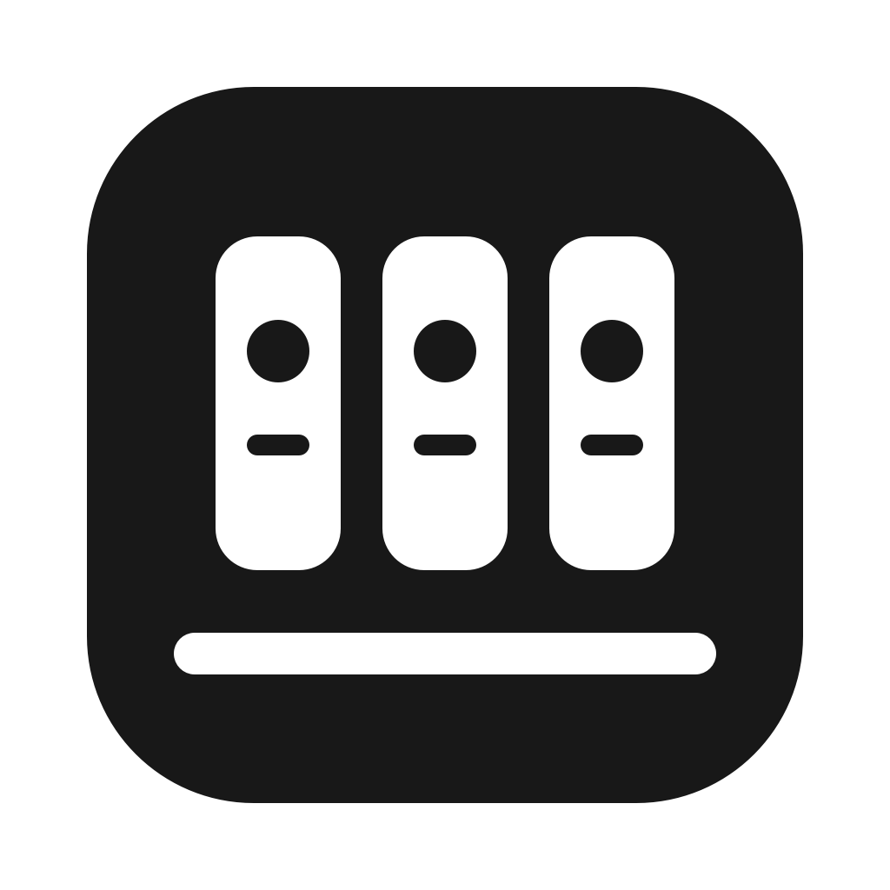
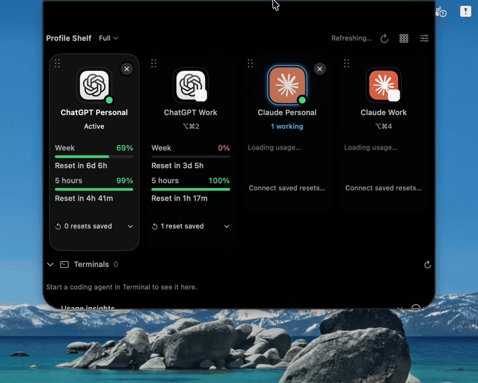
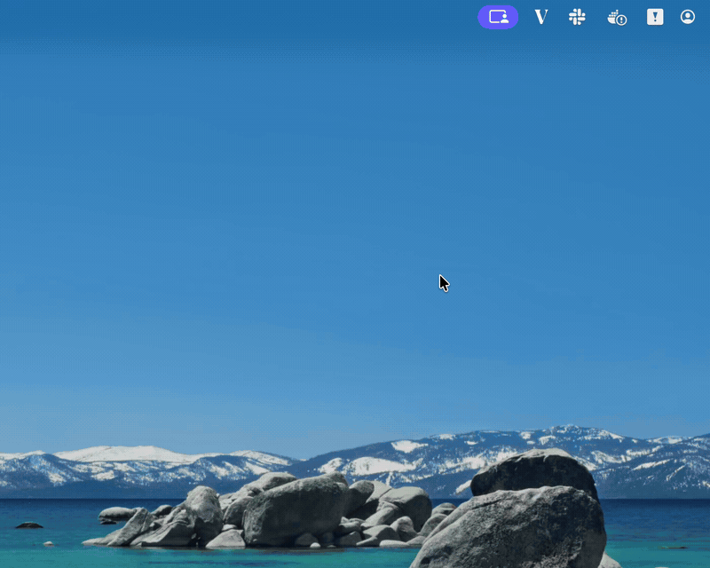
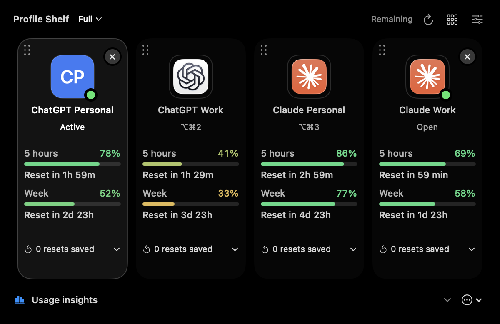
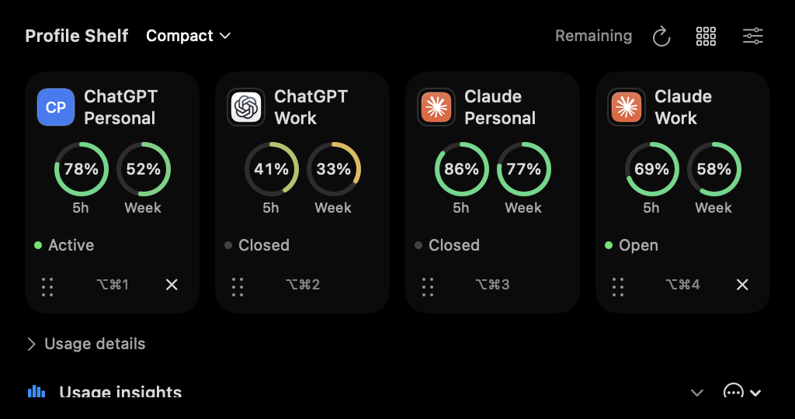
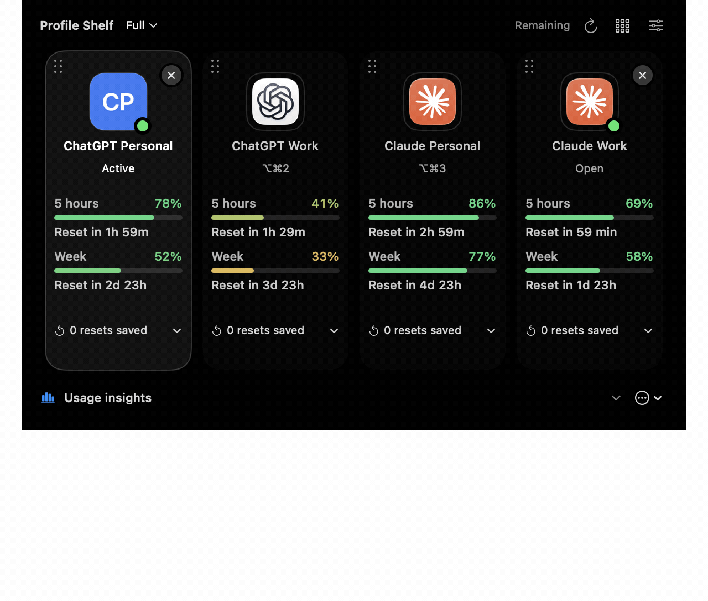
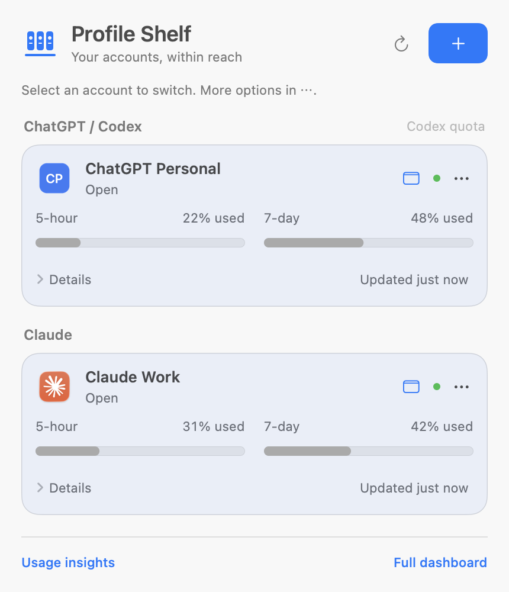
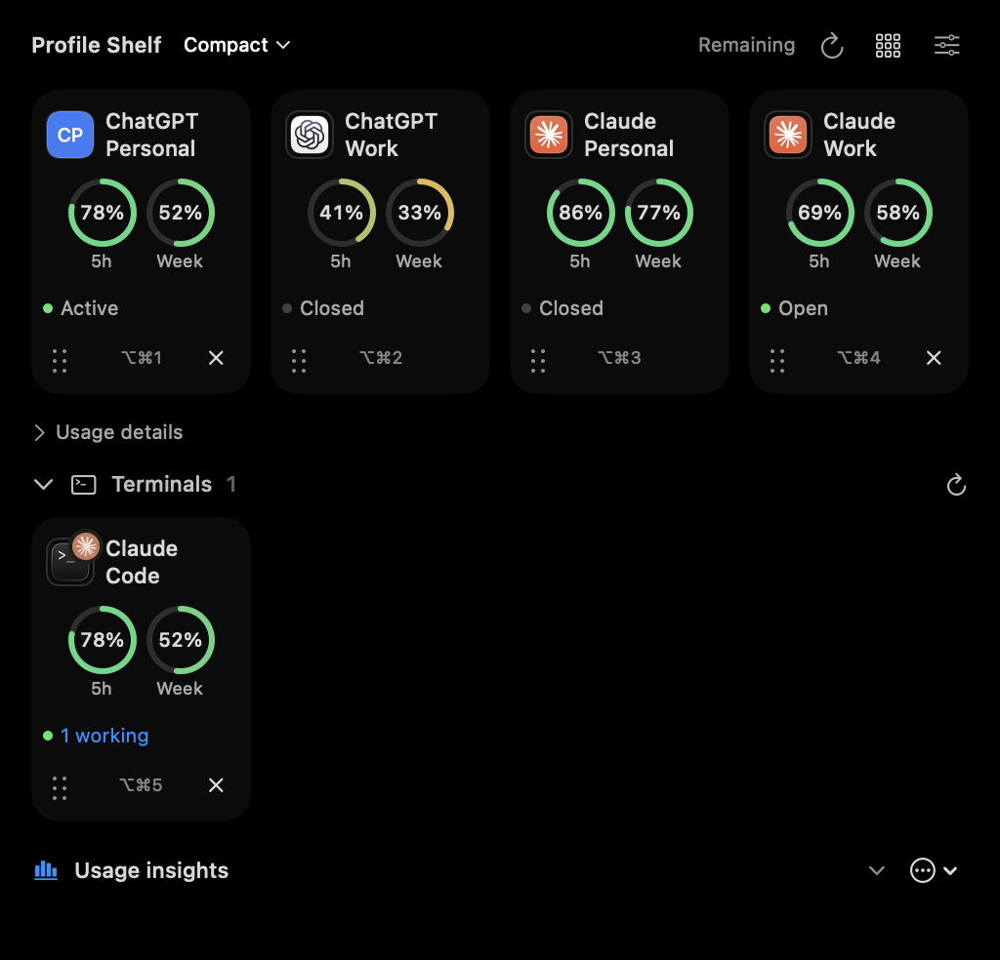

<picture>
  <source media="(prefers-color-scheme: dark)" srcset="Resources/IconPreviews/light.png">
  
</picture>

# Profile Shelf

Switch between work and personal AI app accounts from your Mac’s notch or menu bar. Open accounts alongside each other and check supported provider usage without hunting through windows.

**Free and open source · macOS 14+ · Apple Silicon · 0.1.0**

[Download](#download) · [Build from source](#build-from-source) · [User guide](docs/GUIDE.md) · [Supported tools](docs/AGENT-COVERAGE.md) · [Privacy](PRIVACY.md)

<picture>
  <source media="(prefers-reduced-motion: reduce)" srcset="docs/media/switch.png">
  
</picture>

*Screen recording of the real app. Click a closed account: the open one quits and the new one launches. The wait for the app to quit is sped up 3×.*

- **Switch deliberately.** Switch to another account, or choose **Open alongside** to keep supported accounts open together.
- **See what’s busy.** Accounts with running tasks glow and show what’s working, waiting or finished.
- **Choose your footprint.** Full keeps the larger cards; Compact keeps usage rings and expands the details when you need them.
- **Keep the menu bar optional.** Use the notch, menu bar, or both. Hide the usage numbers with Icon only.
- **Reach desktop and terminal tools.** ChatGPT/Codex, Claude and supported coding tools share one switcher. Separate sign-ins depend on the tool.

<picture>
  <source media="(prefers-reduced-motion: reduce)" srcset="docs/media/working-wide.png">
  
</picture>

*Screen recording of the real app: the panel opens from the notch, and accounts with running tasks glow.*

### Privacy at a glance

- No account system, analytics or Profile Shelf server. Usage insights stay on your Mac.
- To show usage, it reads each profile’s existing ChatGPT sign-in, and the `Claude Code-credentials` Keychain item for Claude, and sends those requests directly to OpenAI and Anthropic over HTTPS. Tokens are never logged or saved to its preferences.
- It never uses or redeems saved resets. [Full privacy details](PRIVACY.md).

## Download

Download **ProfileShelf-0.1.0.dmg** from the [latest release](https://github.com/haiderali136a/profile-shelf/releases/latest), open it and drag Profile Shelf to Applications. You need an Apple Silicon Mac with macOS 14 or newer, and the current **ChatGPT desktop app** and/or **Claude Desktop**.

Profile Shelf is not notarized by Apple yet, so macOS blocks it the first time you open it:

1. Open Profile Shelf once and close the warning.
2. Go to **System Settings → Privacy & Security**, scroll down and click **Open Anyway** next to Profile Shelf.
3. Confirm with your password. After that it opens normally.

To check the download, compare `shasum -a 256 ProfileShelf-0.1.0.dmg` with `SHA256SUMS` in the release. There is no automatic update yet; download new versions from the releases page.

## Build from source

You need:

- An Apple Silicon Mac with **macOS 14** or newer.
- **Xcode with Swift 6** (built and tested with Xcode 27.1), its Command Line Tools, and **Python 3**. Complete Xcode’s first-launch setup. The first dependency download needs internet access.
- The current **ChatGPT desktop app** and/or **Claude Desktop** for desktop profiles. ChatGPT Classic is not supported. Profile Shelf does not include or redistribute either app.

```sh
git clone https://github.com/haiderali136a/profile-shelf.git
cd profile-shelf
bash build.sh
open "dist/Profile Shelf.app"
```

The script runs the test suite and package checks, then builds the Apple Silicon app. The first build takes a few minutes. To install in `~/Applications`, quit Profile Shelf first and run:

```sh
bash build.sh --install
```

The installer retains a verified rollback; ChatGPT and Claude can stay open. Local builds and release downloads are ad hoc signed, not notarized. [Build validation and optional preview path](docs/TEST-RESULTS.md).

## Start using it

1. Open **Profile Shelf** from Applications or Spotlight.
2. Select **Add profile** and choose the app or tool. Sign in inside the provider’s own app.
3. **Hover at the top center** of any display to open the strip. Click a profile, or press ⌥⌘1–9. You can also switch from the menu-bar icon.
4. Connect usage only where offered. Check the account identity in the provider app before working.

Opening a closed account through **Switch** requests a normal quit of the other account for that provider. It never force quits. **Open alongside** keeps supported accounts open together. Switch progress, failures, and recovery actions are shown in the panel.

Activity colors: blue means working, orange needs your input, green is idle, red has unread results, and gray is closed or unknown. The account window’s **Full dashboard** opens all settings and supported tools.

## Full or Compact

Choose **Full** or **Compact** in the notch header or **Appearance → Profile Strip → Layout**. Your accounts, shortcuts and saved Full settings stay in place. In Compact, click the usage rings to expand reset times and other usage details without switching accounts.





*Native app views with fictional profiles and sample usage values. [About these images](docs/media/README.md).*

<details>
<summary>See Full → Compact → expanded usage details</summary>

<picture>
  <source media="(prefers-reduced-motion: reduce)" srcset="docs/media/compact-details.png">
  <source media="(prefers-color-scheme: dark)" srcset="docs/media/layouts-dark.gif">
  
</picture>

A sequence of native view captures with sample data, not a recording of live account interactions. The fixed canvas shows the layouts’ relative sizes. A static view is supplied for reduced motion.

</details>

## Account switcher and optional menu-bar usage

Click the menu-bar icon or open Profile Shelf for the account switcher. **Full dashboard** opens all settings; **Compact view** in the dashboard returns here. This window is separate from the notch’s Full/Compact layout.

<picture>
  <source media="(prefers-color-scheme: dark)" srcset="docs/media/quick-dark.png">
  
</picture>

*Two-profile example. Longer account lists scroll inside the bounded window.*

<picture>
  <source media="(prefers-color-scheme: dark)" srcset="docs/media/menu-dark.png">
  
</picture>

The optional summary tracks **one remembered account per provider**, never a combined quota. Hover the actual menu-bar item to identify the accounts. Choose **General → Menu bar style → Icon only** to hide the numbers, or **Quick access → Notch only** to remove the menu item. It uses the normal shared refresh schedule.

The account window and menu bar show usage **used**; the notch labels usage **remaining**. Codex quotas do not represent every ChatGPT chat limit. Usage is shown only where the integration reports it.

## More than desktop accounts

Profile Shelf recognizes 35 desktop and command-line coding tools. Recognizing a tool does not promise a separate sign-in: for example, Antigravity can use the existing sign-in, but separate Antigravity accounts are not supported. Configure tools in **Full dashboard → Coding Agents**.



*Native view capture with fictional profiles and sample usage. A live terminal session appears in its own **Terminals** section below your desktop accounts.*

Also included:

- **Search earlier chats** across local Work/Codex conversations, with phrase, source and date filters.
- **Context access**, off by default: let one profile look up another’s earlier conversations, in one direction only.
- **Usage insights**: tokens, API-equivalent estimates and sessions for today, 7 or 30 days. Local history only, not your bill.
- **Profile icons**: colors, letters or your own image, with an experimental native Dock icon for ChatGPT profiles.
- **ChatGPT updates on your terms**: update the app groups you can restart.
- **Place it anywhere**: keep it at the notch, or drag a floating strip to any spot on each display.

[App coverage](docs/AGENT-COVERAGE.md) · [Claude and Terminal](docs/CLAUDE-TERMINAL.md) · [Context access](docs/CONTEXT.md) · [Usage insights](docs/INSIGHTS.md) · [Native Dock icons](docs/NATIVE-DOCK.md).

## Coming from an older build

Profile Shelf uses its own app identity and folders, and does not read data from older builds or from ProfileDock. To bring existing ChatGPT profiles across, use **Import or Restore Profiles**; the old folders are left untouched. Do not run Profile Shelf alongside ProfileDock or an older build. [Identifiers and old folders](docs/REBRANDING.md).

## Uninstall

Turn off **General → Open at login** if enabled, quit Profile Shelf, and move `~/Applications/Profile Shelf.app` to the Trash. This removes the manager while retaining profile data and provider apps. See [uninstall and data retention](docs/GUIDE.md#uninstall-and-data-retention) for generated shortcuts and optional context integrations.

## Develop and contribute

See [CONTRIBUTING.md](CONTRIBUTING.md) for checks and contribution guidance, and [branding](docs/BRANDING.md) for editable assets. Use fictional profiles in demos; never commit tokens, account files, private histories or build output.

## License and credits

Based on [ProfileDock](https://github.com/breukr/profiledock) ([what changed](docs/CHANGES.md)). MIT licensed. Copyright, credits, and dependency notices are preserved in [LICENSE](LICENSE), [ACKNOWLEDGMENTS.md](ACKNOWLEDGMENTS.md), and [THIRD_PARTY_NOTICES.md](THIRD_PARTY_NOTICES.md).

Independent software, not affiliated with the supported app vendors. Profiles are a convenience within one macOS user account, not a security boundary.
